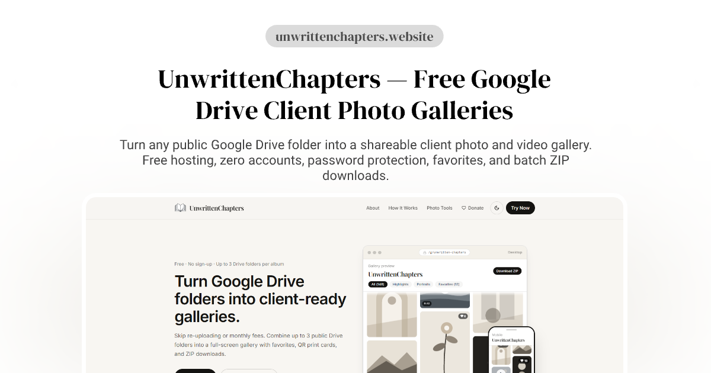
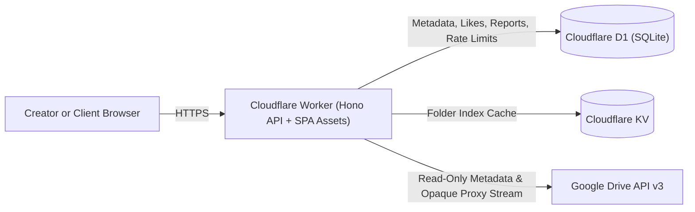

<div align="center">
  

  <h1>UnwrittenChapters</h1>

  <p>
    <strong>Turn any public Google Drive folder into a fast, client-ready photo &amp; HD video gallery — hosted for $0/month.</strong>
  </p>

  <p>
    <a href="https://unwrittenchapters.website">
      
    </a>
    
    
    
    
  </p>

  <p>
    <a href="#-features">Features</a> &bull;
    <a href="#%EF%B8%8F-architecture">Architecture</a> &bull;
    <a href="#-local-development">Quick Start</a> &bull;
    <a href="#-production-deployment">Deployment</a> &bull;
    <a href="#-security-model">Security</a> &bull;
    <a href="#-releases--support">Releases</a>
  </p>

  <br />

  
</div>

---

## Overview

**UnwrittenChapters** wraps existing Google Drive folders (`Anyone with the link → Viewer`) in a clean, client-ready gallery experience without re-uploading gigabytes or paying monthly storage subscriptions. Your original media never leaves Google Drive—Cloudflare Workers handles indexing, opaque media proxying, password gates, and studio customization.

---

## ✨ Features

| Area | What It Does |
| :--- | :--- |
| **Zero Sign-Up Workflow** | Paste a public Google Drive folder link to generate a client **Share Link** (`/g/<slug>`) and private **Manage Link** (`/g/<slug>/manage#<token>`). |
| **Whole-Gallery Theming** | Customize Masonry, Justified, or Square grids, presets (`light`, `dark`, `warm`, `sage`, `midnight`, or custom hex tokens), typography (`sans`, `serif`, `fineart`, `mono`), hero layout, photo frame style, captions, and studio branding with live desktop/mobile preview. |
| **HD Photos & Video** | Crawls nested folders up to **3 levels deep** (up to **40 subfolders** / **2,000 items**), renders full-resolution PhotoSwipe lightboxes, and streams HD video via HTTP `Range` requests. |
| **Client Favorites & Export** | Clients heart favorite photos/videos; creators review picks and copy or export selected filenames directly as `.txt` or `.csv` for **Lightroom** / **Capture One** filtering. |
| **Client-Side Batch ZIP** | Streams full-resolution downloads straight into a ZIP archive in the visitor's browser via `client-zip` (zero server ZIP memory overhead). |
| **SEO & Client Privacy** | Homepage ships with Open Graph, Twitter Card, `WebApplication` + `FAQPage` JSON-LD, `robots.txt`, and `sitemap.xml`, while `/g/*` and `/api/*` enforce `noindex, nofollow`. |

---

## 🏗️ Architecture



<details>
<summary><strong>Repository Structure</strong></summary>

```text
├── migrations/                  # Cloudflare D1 SQL migrations (0001_init .. 0003_gallery_theming)
├── public/                      # Static assets (logo, og-cover.png, icons, qr, robots.txt, sitemap.xml)
├── src/
│   ├── client/                  # React 19 + Tailwind CSS v4 SPA
│   │   ├── components/          # StudioBuilder, GallerySurface, GalleryStyleControls, DonateModal, etc.
│   │   ├── config/              # Donation QR config & select options
│   │   ├── lib/                 # API client, browser ZIP streamer, per-route SEO hook
│   │   └── pages/               # HomePage, GalleryPage, ManagePage
│   ├── server/                  # Hono Worker API & Drive media proxy
│   │   ├── routes/              # bible.ts, galleries.ts, media.ts
│   │   ├── crypto.ts            # PBKDF2-SHA256 hashing & HMAC session tokens
│   │   ├── drive.ts             # Google Drive API v3 folder crawler
│   │   ├── opaqueIds.ts         # Deterministic opaque file/folder ID mapping
│   │   └── security.ts          # Rate limits, Turnstile verification, CSRF & schema checks
│   └── shared/                  # Shared TS types, theme presets, Google Form links
├── test/                        # Vitest suite (api.test.ts, crypto.test.ts, drive.test.ts)
├── docs/
│   └── CLOUDFLARE_DEPLOYMENT.md # Step-by-step Cloudflare Workers + D1 + KV guide
├── CHANGELOG.md                 # Release notes & version history
└── wrangler.jsonc               # Cloudflare Workers, D1, KV, and public variables config
```

</details>

---

## 🛠️ Tech Stack

| Layer | Technology |
| :--- | :--- |
| **Frontend** | React 19, Vite 6, Tailwind CSS v4, PhotoSwipe 5, Lucide Icons, `client-zip` |
| **Edge Backend** | Cloudflare Workers (`@cloudflare/vite-plugin`), Hono 4 |
| **Database & Cache** | Cloudflare D1 (SQLite), Cloudflare KV, Google Drive API v3 |
| **Testing** | Vitest 3 + Cloudflare Vitest Pool Workers |

---

## 🚀 Local Development

<details open>
<summary><strong>Step-by-step local setup</strong></summary>

1. **Install dependencies:**
   ```bash
   npm install
   ```

2. **Create `.dev.vars`** from `.dev.vars.example` *(never commit `.dev.vars`)*:
   ```env
   GOOGLE_DRIVE_API_KEY=your_google_cloud_api_key_here
   COOKIE_SIGNING_SECRET=replace_with_at_least_32_character_random_hex_string
   TURNSTILE_SECRET_KEY=
   ADMIN_MODERATION_KEY=replace_with_strong_random_moderation_key
   PUBLIC_DONATE_URL=
   PUBLIC_FEEDBACK_FORM_URL=
   PUBLIC_REPORT_FORM_URL=
   PUBLIC_TURNSTILE_SITE_KEY=
   ```
   > **Tip:** Enable **Google Drive API** in Google Cloud Console → *APIs & Services → Library*, generate an API key, and restrict it strictly to **Google Drive API**.

3. **Apply local D1 migrations:**
   ```bash
   npm run db:migrate:local
   ```

4. **Run the dev server & verification checks:**
   ```bash
   npm run dev        # Start local Vite + Cloudflare Worker dev server
   npm run typecheck  # TypeScript check
   npm test           # Run Vitest unit & Worker API security tests
   npm run build      # Build production SSR Worker & client assets
   ```

</details>

<details>
<summary><strong>Environment Variables &amp; Customization Reference</strong></summary>

| Variable | Type | Purpose |
| :--- | :--- | :--- |
| `GOOGLE_DRIVE_API_KEY` | Secret | Google Cloud API key restricted to Google Drive API v3 |
| `COOKIE_SIGNING_SECRET` | Secret | 32+ char secret for HMAC cookies (`uc_admin_*`, `uc_unlock_*`) & opaque IDs |
| `ADMIN_MODERATION_KEY` | Secret | Operator key for moderation endpoints |
| `TURNSTILE_SECRET_KEY` | Secret *(opt)* | Cloudflare Turnstile verification secret |
| `PUBLIC_TURNSTILE_SITE_KEY` | Var *(opt)* | Turnstile widget site key |
| `PUBLIC_FEEDBACK_FORM_URL` | Var *(opt)* | Overrides default feedback form URL in `src/shared/contact.ts` |
| `PUBLIC_REPORT_FORM_URL` | Var *(opt)* | Overrides default abuse report form URL in `src/shared/contact.ts` |
| `PUBLIC_DONATE_URL` | Var *(opt)* | Optional external donation URL (paired with `public/qr/maya.png`) |

</details>

---

## ☁️ Production Deployment

Follow the complete guide in **[docs/CLOUDFLARE_DEPLOYMENT.md](docs/CLOUDFLARE_DEPLOYMENT.md)** for full Cloudflare Dashboard UI & CLI instructions (D1 + KV provisioning, remote migrations, secrets, Turnstile, and custom domains).

Quick deploy after D1, KV, and secrets are configured:

```bash
npm run db:migrate:remote
npm run deploy
```

---

## 🔒 Security Model

- **30-Day `HttpOnly` Manage Cookies & Token Rotation:** Manage links exchange `#token` fragments into `HttpOnly`, `SameSite=Lax`, HMAC-signed `uc_admin_<slug>` cookies (`Path=/api/galleries`), with instant token rotation in **Manage → Access**.
- **Opaque Proxy Identifiers:** Public responses and `/api/media/:slug/:fileId` URLs expose HMAC-derived opaque IDs rather than raw Google Drive IDs.
- **Zero-Trust Validation:** PBKDF2-SHA256 gallery passwords (`6–128` chars), same-origin CSRF enforcement on mutating API calls, strict `(slug, fileId)` proxy allowlisting, per-IP rate limits, bounded JSON payloads, and optional Turnstile verification.

---

## 📦 Releases & Support

- **Changelog:** Tracked in **[CHANGELOG.md](CHANGELOG.md)** and [GitHub Releases](https://github.com/josiahjezraelguevarra/UnwrittenChapters/releases).
- **Feedback & Suggestions:** [Submit via Google Form](https://forms.gle/WMc6seyhcdsagxwF7)
- **Report a Gallery / DMCA:** [Submit via Google Form](https://forms.gle/6vnSTLan1Pc5CZih9)
